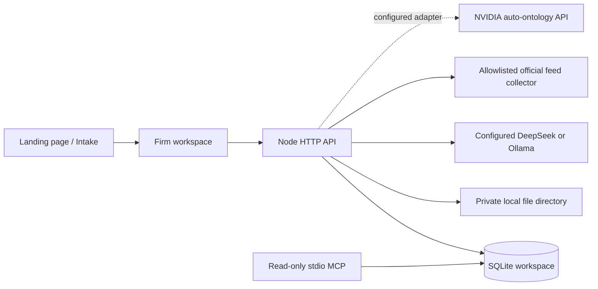

# Connected architecture

## Implemented prototype

The static preview uses browser storage in place of the API. SQLite stores a revisioned workspace document. Optimistic revision checks reject stale writes. This is a small prototype persistence model, not the normalized relational data model intended for a multi-user firm.

The Node service restricts hosts, blocks cross-origin writes, caps request sizes, serves uploads as attachments, rate limits model requests, and requires a shared password when exposed to a network. The audit trail is editable workspace data, not a tamper-evident compliance log. There is no production user or role separation yet.

## Target architecture

Use PostgreSQL 17 with pgvector and row-level access rules for production. Normalize matters, parties, relationships, incidents, events, files/versions, messages, tasks, expenses, trust transactions, workflows and approvals. Use S3-compatible object storage, versioning and encrypted backups for files. Avoid simultaneous Neo4j and Qdrant deployments until a measured need justifies separate graph/vector stores.

Use Keycloak for firm identity and MFA. Map principal, attorney, paralegal, intake, finance and client roles to explicit matter permissions. A user’s role alone must not expose every matter. Keep public intake isolated from private operations and from internal model tools.

Use Temporal for durable execution; Hermes can prepare bounded tool plans against matter-scoped MCP tools. All external effects are separate approved operations with idempotency keys and delivery receipts. Treat incoming files, emails, search results and model text as data; they cannot change permissions, system instructions or approval policy.

OpenJarvis is an optional local assistant layer. It is not assumed to provide a turnkey phone receptionist. Pipecat orchestrates speech streams; faster-whisper transcribes; Piper or another evaluated local TTS generates speech. Verify language and voice licensing separately. Asterisk handles SIP and escalation; carrier access remains external and paid.

## Ontology for Adnan and junior attorneys

The initial graph shows explicit relationships, not machine-extracted legal knowledge. The staging export creates matter/document relational tables that NVIDIA auto-ontology can inspect once loaded into a dedicated PostgreSQL source. It is not an auto-ontology import format and does not by itself deploy or configure that product.

Proposed entity vocabulary: Client, Matter, Incident, Injury, TreatmentEvent, Provider, Insurer, Policy, Adjuster, Attorney, Court, Judge, Filing, Deadline, Evidence, Citation, Offer, Settlement, Lien, Expense and Approval.

Every extracted assertion must carry source file/version, page or span, extraction model/version, timestamp, confidence, reviewer and certification status. Keep reported facts, corroborated facts, legal propositions and attorney conclusions distinct. Never infer medical causation or settlement values as established facts from incomplete records.

NVIDIA’s current project builds a semantic layer over structured data, with human certification. It is not a complete litigation document extraction system. Add OCR, parsing and entity review separately. Its backend/ingestion ports must stay private. Its user-scoped MCP tools can be made available to Hermes after an actual deployment is authenticated and its results are tested.

## Update behavior

The optional feed collector retrieves bounded RSS/Atom snapshots over HTTPS from official domains, rejects redirects, hashes content and queues changed snapshots. It does not claim to identify legal holdings or effective dates. Set `LAW_POLL_MINUTES` to at least 15 to enable the in-process interval. It runs only while the Node process is running and the configured feeds are reachable. Production should move this to durable scheduling with retrieval history and retry alerts.

No statute, deadline or document template is silently rewritten from a feed. A reviewed update should produce a proposed impact analysis, affected matters and a review decision. Preserve the prior version and reviewer before applying changes.
